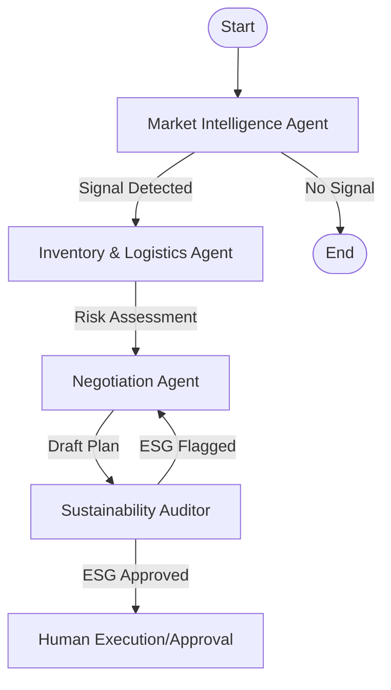

# 🌐 Autonomous Supply Chain Orchestrator


> **A local-first, privacy-focused autonomous system that monitors global events, assesses supply chain risks, negotiates with suppliers, and enforces sustainability standards—all without human intervention until the final approval.**

---

## 📖 Table of Contents

- [Overview](#-overview)
- [Key Features](#-key-features)
- [Architecture & Agents](#-architecture--agents)
- [Prerequisites](#-prerequisites)
- [Installation](#-installation)
- [Configuration](#-configuration)
- [Usage](#-usage)
- [Project Structure](#-project-structure)
- [Troubleshooting](#-troubleshooting)

---

## 🚀 Overview

The **Autonomous Supply Chain Orchestrator** is a multi-agent AI system designed to proactively manage supply chain disruptions. Unlike traditional distinct chatbots, this system operates as a cohesive unit where specialized AI agents collaborate to:

1. **Detect** real-time threats (e.g., strikes, natural disasters) using global news feeds.
2. **Assess** the specific impact on local inventory and logistics.
3. **Plan** a mitigation strategy (e.g., alternative suppliers) that includes drafting communication.
4. **Audit** the plan against strict ESG (Environmental, Social, Governance) criteria.

The entire workflow is orchestrated using **LangGraph**, ensuring a robust state machine that can handle failures, retries, and complex logic flow.

---

## ✨ Key Features

- **Multi-Agent Collaboration**: Four specialized agents working in harmony.
- **Local Privacy**: Runs primarily on your local machine using **Ollama** models, keeping sensitive data private.
- **Strategic Reasoning**: Uses **DeepSeek-R1** for complex problem-solving and negotiation strategies.
- **ESG Compliance**: A dedicated "Conscience" agent ensures all actions align with sustainability goals (carbon neutrality, fair labor).
- **Vector Memory**: Utilizes **ChromaDB** to store and retrieve historical solutions and context.
- **Real-time Monitoring**: Integrates with **NewsAPI** for live signal detection.

---

## 🏗 Architecture & Agents

The system is built on a modular architecture where each agent has a specific role, personality, and optimal LLM.



### 🕵️‍♂️ 1. Market Intelligence ("The Eyes")

- **Model**: `llama3.2` (Fast)
- **Role**: Scans global news feeds for potential supply chain disruptions.
- **Tech**: NewsAPI, LangChain.

### 🛠 2. Inventory & Logistics ("The Hands")

- **Model**: `mistral` (Reliable Tool Use)
- **Role**: Interfaces with internal data (mock ERP/CSV) to quantify the impact of a disruption on current stock levels.
- **Tech**: Pandas, CSV.

### 🗣 3. Negotiation Agent ("The Voice")

- **Model**: `deepseek-r1` (Reasoning)
- **Role**: Formulates high-level strategies and drafts communications (emails/messages) to suppliers to mitigate risks. It retrieves past successful strategies from memory.
- **Tech**: ChromaDB (RAG).

### ⚖️ 4. Sustainability Auditor ("The Conscience")

- **Model**: `llama3.2` (Logic/Verification)
- **Role**: The gatekeeper. It audits the Negotiation Agent's plans to ensure they meet ESG standards (e.g., prioritizing low-carbon routes, fair labor).
- **Tech**: LangChain Logic.

---

## 📋 Prerequisites

Before setting up, ensure you have the following:

1. **Python 3.9+**: [Download Here](https://www.python.org/downloads/)
2. **Ollama**: The local LLM runner. [Download Here](https://ollama.com/)
3. **API Keys**:
    - **NewsAPI**: Get a free key at [newsapi.org](https://newsapi.org).

---

## 💾 Installation

### 1. Clone the Repository

```bash
git clone https://github.com/yourusername/autonomous-supply-chain.git
cd autonomous-supply-chain
```

### 2. Set Up Virtual Environment (Recommended)

```bash
# Windows
python -m venv venv
.\venv\Scripts\activate

# Mac/Linux
python3 -m venv venv
source venv/bin/activate
```

### 3. Install Dependencies

```bash
pip install -r requirements.txt
```

### 4. Pull Ollama Models

The system requires specific models for different roles. Run these commands in your terminal:

```bash
ollama pull deepseek-r1    # For high-level reasoning
ollama pull llama3.2       # For fast monitoring & auditing
ollama pull mistral        # For reliable tool use
ollama pull nomic-embed-text # For vector embeddings
```

---

## ⚙️ Configuration

1. Create a `.env` file in the root directory.
2. Add your API keys and configuration:

```ini
# API Keys (Required)
NEWS_API_KEY=your_newsapi_key_here

# Optional: Search API (if configured in code)
SERPER_API_KEY=your_serper_key_here

# Database Config
CHROMA_DB_PATH=./chroma_db

# Model Overrides (Optional - defaults shown)
OLLAMA_MODEL_REASONING=deepseek-r1
OLLAMA_MODEL_FAST=llama3.2
OLLAMA_MODEL_TOOL=mistral
OLLAMA_BASE_URL=http://localhost:11434
```

---

## 🏃 Usage

Start the orchestrator by running the main entry point:

```bash
python main.py
```

### What to Expect

1. **Step 1**: The system will fetch the latest news on "supply chain disruptions".
2. **Analysis**: If a threat is found, it will ripple through the agents (Inventory -> Negotiation -> Audit).
3. **Output**: You will see a real-time log of the agents' thoughts and actions.
4. **Approval**: If a valid, sustainable plan is generated, the system will pause and ask for your final approval ("Human-in-the-loop").

---

## 📂 Project Structure

```text
├── agents/                 # Agent implementations
│   ├── market_intelligence.py
│   ├── inventory_logistics.py
│   ├── negotiation.py
│   └── sustainability.py
├── core/                   # Core infrastructure
│   ├── config.py           # Configuration loader
│   ├── llm.py              # LLM factory
│   └── memory.py           # ChromaDB wrapper
├── data/                   # Data storage
│   └── inventory.csv       # Mock ERP data
├── workflows/              # LangGraph definitions
│   └── orchestrator_graph.py
├── main.py                 # Entry point
├── requirements.txt        # Python dependencies
└── .env                    # Environment variables
```

---

## ❓ Troubleshooting

**Q: "Connection refused" or Ollama errors?**
A: Ensure Ollama is running in the background (`ollama serve` or open the desktop app).

**Q: "API Key missing"?**
A: Double-check your `.env` file and make sure you've installed `python-dotenv`.

**Q: The agents perform poorly or hallucinate?**
A: Ensure you have pulled the correct models (`deepseek-r1` is crucial for reasoning). You can also try updating the models (`ollama pull [model]`).

---
*Built for the Autonomous Future.*
